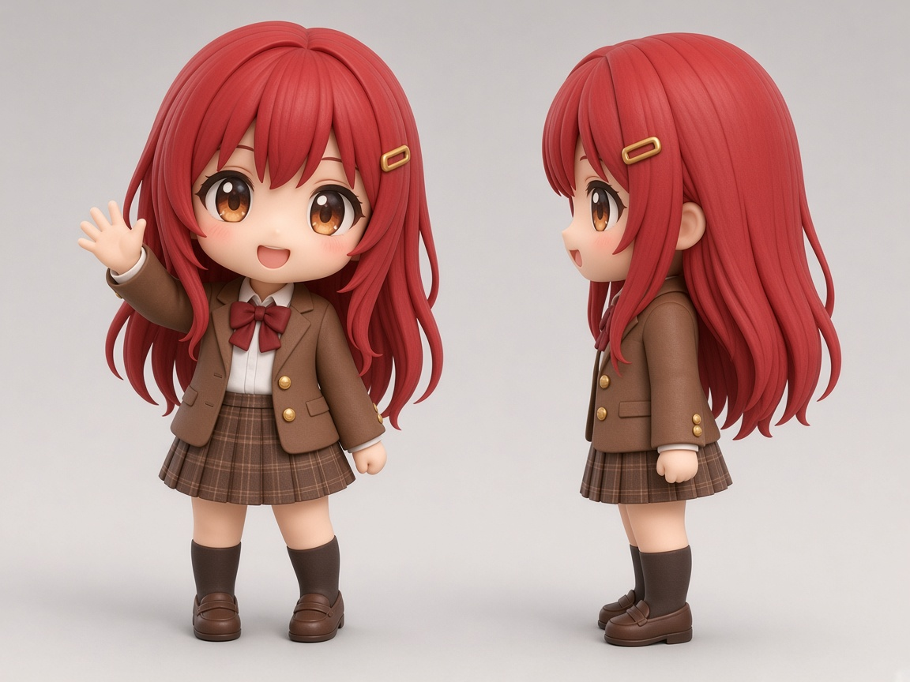

# 正式玩家角色：設計同 VRoid 製作步驟

呢張係 Sean 定咗嘅最終設計。下面係用 VRoid Studio 整出嚟嘅步驟。**全部未試過**：VRoid 唔同版本嘅 slider 名同位置可能唔同，搵唔到就揾意思最近嗰個。

## 1. 素體

- 用「いつつ用ちび素体」（CC0）做底：https://hub.vroid.com/en/characters/4546129584464005032/models/7883792065184134379
- 開工前喺 browser 再睇一次作者頁面嘅條款同備註，確認仲係 CC0、可以改同再發佈。

## 2. 比例（Body）

- 頭：Head size 拉到最大，全身大約 2 頭身。
- 身高、手臂、腳都調短。
- 手同腳掌稍為大少少（chibi figure 感）。

## 3. 面（Face）

- 眼：琥珀色 `#B8662A`，加白色 highlight。
- 鼻：好細。
- 口：微笑。
- 腮紅：淺粉紅。

## 4. 頭髮（Hair）

- 長直髮，去到背中間。
- 兩邊側髮垂到心口。
- 主色 `#C8282E`，陰影色 `#8E1A20`。
- 金色髮夾 `#D4A23A`（一邊頭）。

## 5. 校服（Outfit）

| 部分 | 顏色 |
| --- | --- |
| 啡色 blazer，金鈕 | `#7A5236` |
| 白恤衫 | 白 |
| 深紅色煲呔 | `#8E1F2A` |
| 啡格仔百褶裙 | 主色 `#6B4A33`，格線 `#A07E5C` |
| 深啡長襪（到膝頭） | `#3B2A22` |
| 啡色 loafers | `#5A3A26` |

## 6. 描邊同陰影

- VRoid 嘅 outline 調幼或者關。
- 陰影調軟。
- 公仔（figure）質感唔靠 VRoid，靠烘焙時 C++ 生成嘅物料（`data/config/player.json` 嘅 `"materials": "figure"`）。想加描邊就喺 `player.json` 開 `"outline": true`。

## 7. Export 同放入遊戲

1. Export VRM（0.0 或 1.0 都得）。Author 寫你自己，授權揀容許修改／再發佈。
2. 存做 `data/characters/player.vrm`。
3. 跟 `data/characters/README.md` 「換自己嘅 VRoid 模型」：裝 VRM4U、build、重新烘焙。**唔使改 code。**
4. 想清走暫代角色，跟同一份 README 「刪走暫代角色」。

## 8. 喺 PIE 要睇

- 腳踩地（唔浮唔陷）、面向前（唔啱就改 `mesh_yaw_deg`）。
- 大頭會唔會被手臂穿過（idle、跑步）。
- 頭髮、裙有冇穿模。VRoid 嘅 spring bone 喺呢個 C++ AnimInstance 入面**唔會郁**（見 `docs/STATUS.md`）。
